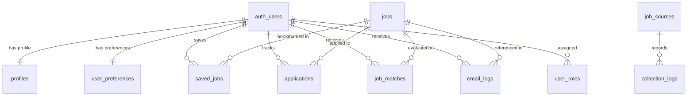

# JobCurrent — Database Schema & Row Level Security

All database tables are defined in PostgreSQL via Supabase migrations (`backend/supabase/migrations/`).

---

## 📊 Entity Relationship Diagram

---

## 🔒 Row Level Security (RLS) Policies

| Table | Policy Scope | Access Rule |
|---|---|---|
| `profiles` | Private | `auth.uid() = id` (Read/Insert/Update) |
| `user_preferences` | Private | `auth.uid() = user_id` (Read/Insert/Update) |
| `saved_jobs` | Private | `auth.uid() = user_id` (All operations) |
| `applications` | Private | `auth.uid() = user_id` (All operations) |
| `job_matches` | Private | `auth.uid() = user_id` (Read only) |
| `jobs` | Public Read | `status = 'active'` for visitors; Admin/Service Role for writes |
| `job_sources` | Admin | `public.is_admin() = true` |
| `collection_logs` | Admin | `public.is_admin() = true` |
| `user_roles` | Admin | `public.is_admin() = true` (Users can read own role) |

---

## ⚡ Free-Tier Index Optimizations

- `idx_jobs_status_posted`: Composite index on `(status, posted_at DESC)` for sub-millisecond public listings queries.
- `idx_jobs_skills`: GIN index on `required_skills` array for fast tag filtering.
- `idx_jobs_desc_hash`: Index on `description_hash` for instant $O(1)$ duplicate detection.
- `idx_job_matches_user_score`: Composite index on `(user_id, match_score DESC)` for immediate dashboard rendering.
